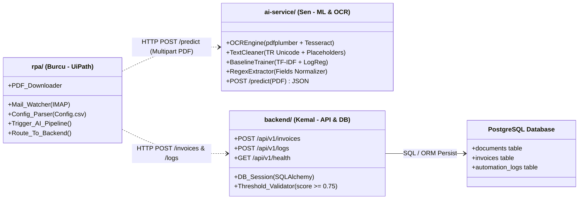
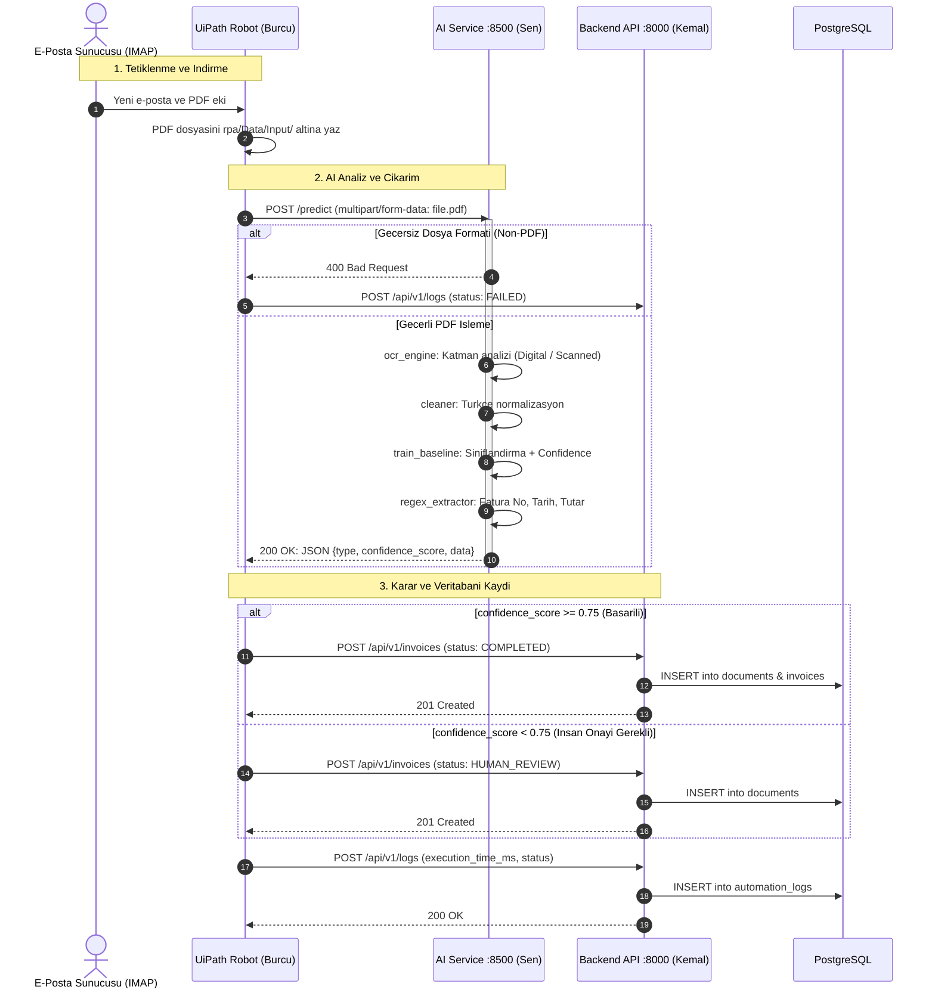
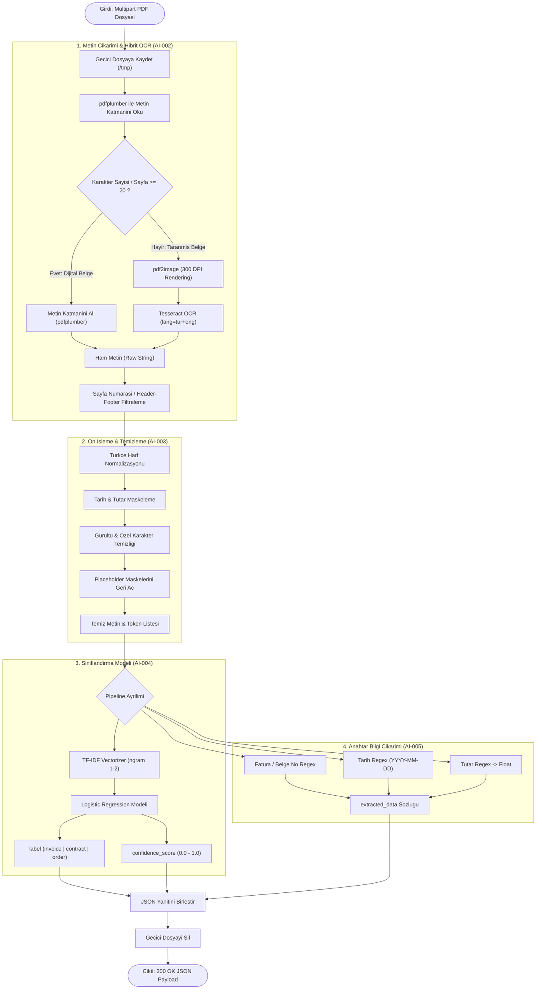

# Intelligent Document Processing & RPA Platform — Architecture Document

Bu doküman, sistem bileşenlerini, servisler arası uçtan uca iletişim akışını ve Yapay Zeka (AI/ML) servisinin iç veri işleme boru hattını (pipeline) tanımlar.

---

## 1. Servisler Arası Sorumluluk ve Bileşen Mimarisi (Component Diagram)

---

## 2. Uçtan Uca Sıralama ve Hata Yönetimi Şeması (Sequence Diagram)

---

## 3. AI & OCR Servisi Veri İşleme Boru Hattı (Pipeline Activity Diagram)

